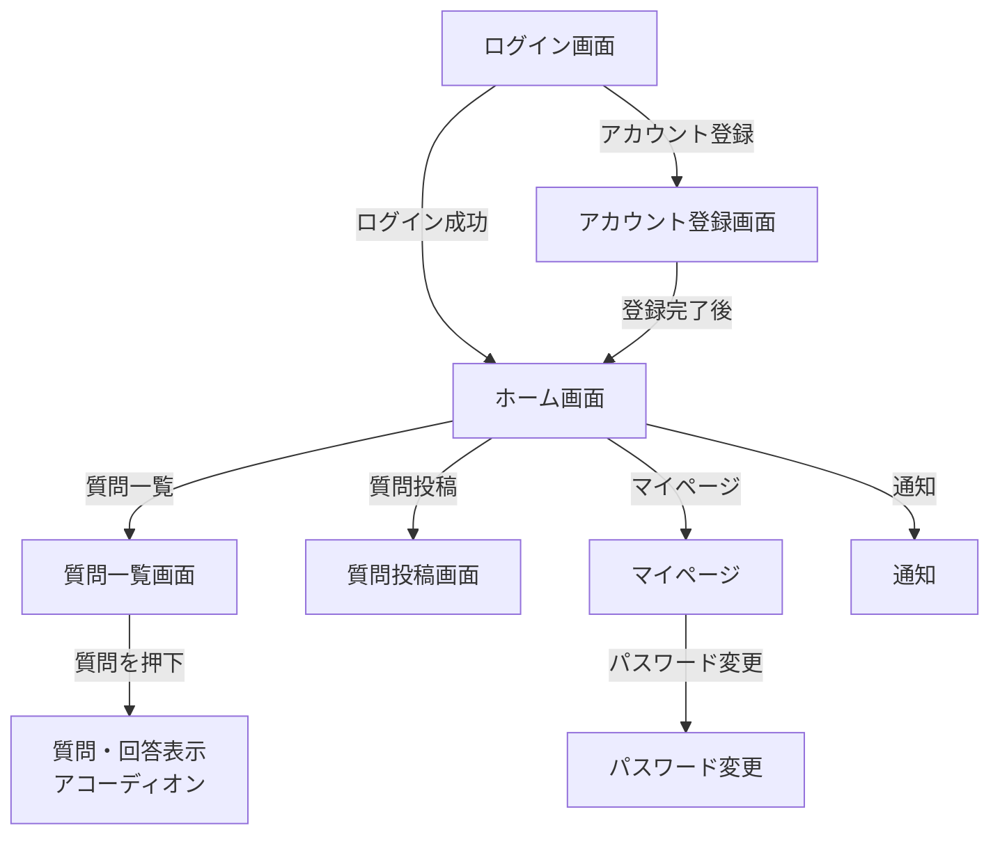

# KnowHub 画面遷移図

## 1. 概要

KnowHub MVPの画面遷移を定義する。

質問の詳細・回答は独立した画面には遷移せず、質問一覧画面内でアコーディオン形式に表示する。

## 2. 画面遷移図

## 3. 画面一覧

| 画面 | 役割 |
|---|---|
| ログイン画面 | KnowHubへログインする |
| アカウント登録画面 | 新しいユーザーを登録する |
| ホーム画面 | 各機能への入口を提供する |
| 質問一覧画面 | 質問の閲覧・検索を行う |
| 質問・回答表示 | 質問一覧内で詳細・回答をアコーディオン表示する |
| 質問投稿画面 | 新しい質問を投稿する |
| マイページ | 自分の質問や回答を確認する |
| パスワード変更 | パスワードを変更する |
| 通知 | 通知を確認する |

## 4. 各画面の遷移

### 4.1 ログイン画面

遷移先：

- アカウント登録画面
- ログイン成功後、ホーム画面

### 4.2 アカウント登録画面

登録完了後、ホーム画面へ遷移する。

### 4.3 ホーム画面

以下の画面へ遷移できる。

- 質問一覧画面
- 質問投稿画面
- マイページ
- 通知

### 4.4 質問一覧画面

質問を選択すると、同じ画面内で質問・回答をアコーディオン形式で表示する。

独立した質問詳細画面は作成しない。

質問・回答表示では以下を確認できる。

- 質問内容
- 質問者
- 投稿日
- 回答期限
- ステータス
- 回答一覧

また、回答を投稿できる。

### 4.5 質問投稿画面

質問を投稿する。

投稿項目：

- 質問カテゴリ
- 質問内容
- 回答期限

### 4.6 マイページ

自分が投稿した質問を確認できる。

質問はアコーディオン形式で表示する。

また、パスワード変更画面へ遷移できる。

### 4.7 通知

アプリ内通知を確認する。

## 5. 共通ナビゲーション

ログイン後の主要画面では、以下の機能へ移動できる導線を設けることを想定する。

- ホーム
- 質問一覧
- 質問投稿
- 通知
- マイページ

具体的なナビゲーションの配置・UIは画面詳細設計で決定する。

## 6. 今後決定する事項

画面遷移図では画面同士の関係を定義し、以下の詳細は画面詳細設計で決定する。

- 各画面の入力項目
- ボタン配置
- バリデーション
- エラーメッセージ
- 画面内のUI
- ログイン状態によるアクセス制御
- 戻る操作の詳細
